<picture>
  <source media="(prefers-color-scheme: dark)" srcset="./public/assets/banner-night.svg">
  
</picture>

# zaiguihuashuxia 的个人主页

<https://zaiguihuashuxia.github.io/> 的源码：GitHub 式的布局，加一点像素画，白天和夜晚跟着主题切换。

- 个人知识书库：<https://zaiguihuashuxia.github.io/notes/>
- GitHub：<https://github.com/zaiguihuashuxia>

## 目录

```text
public/                 GitHub Pages 只发布这个目录
├── index.html          主页，样式和脚本都写在这一个文件里
├── assets/             像素横幅和 less is more 标语，白天、夜晚各一份
└── styles.css          早期版本的样式表，新页面已不再引用
tests/                  主页的基本检查
```

贡献格子图的数据由浏览器从 [github-contributions-api](https://github.com/grubersjoe/github-contributions-api) 实时读取，读取失败时显示一张空白格子图。

## 预览与部署

```bash
python3 -m http.server -d public     # 本地预览：打开 http://localhost:8000
python3 -m unittest discover -s tests
```

推送到 `main` 后，GitHub Actions 会把 `public/` 发布到 GitHub Pages。知识笔记的源码和构建流程在独立的 [`zaiguihuashuxia/notes`](https://github.com/zaiguihuashuxia/notes) 仓库。

> less is more
